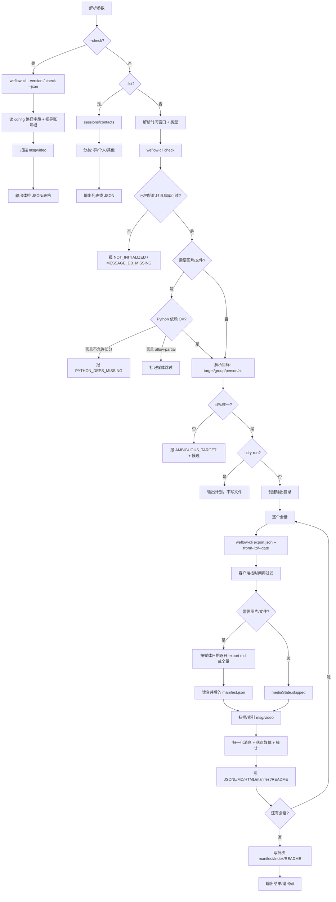

# wechat-export — 设计文档

## 1. 需求编号

| 编号 | 需求 | 实现 |
| --- | --- | --- |
| REQ-001 | 导出微信聊天中的文字消息 | `messages.jsonl` 的 `text`；`transcript.md`；`index.html` |
| REQ-002 | 导出聊天中传输的文件本体 | `weflow-cli export md` 的 `files/` → `media/files/`；缺失写原因 |
| REQ-003 | 导出图片 | `weflow-cli export md` 的图片资产 → `media/images/` |
| REQ-004 | 导出视频本体 | 扫描 `msg/video`，按消息 XML 的 `md5/rawmd5` 匹配 mp4 → `media/videos/` |
| REQ-005 | 按时间筛选 | `--from/--to`、`--date`、`--days`；本地时区；`--to` 含当天 |
| REQ-006 | 按群筛选 | `--group`、`--all-groups`；群 ID 以 `@chatroom` 结尾 |
| REQ-007 | 按个人筛选 | `--person`、`--all-persons`；排除公众号/系统账号 |
| REQ-008 | 一个目录内可浏览 | 批量 `index.html` + 单会话 `index.html`（类型/发送者/关键词筛选） |
| REQ-009 | 机器可读 | `messages.jsonl`、`messages.json`、`manifest.json`、`media/index.json` |
| REQ-010 | 不猜测、缺失可解释 | 媒体缺失写 `missing.reason`，统计里分 found/missing |
| REQ-011 | 只读、本地、不上传 | `weflow-cli` 只读打开数据库；本 skill 无网络调用 |
| REQ-012 | 可批量、可 dry-run、可部分失败 | `--all-*`、`--max-targets`、`--dry-run`、`--allow-partial` |
| REQ-013 | 支持微信 4.2 | `wechat42-export.mjs` + 内置 vendor（wechat-exporter MIT）+ sandbox 重加密 |
| REQ-015 | 文章链接 / 公众号 | `link` 类型 + `appUrl/appTitle` fallback；`--all-official` 批量导出 `gh_*` |
| REQ-016a | 语音音频 | 4.2：`VoiceInfo` → SILK → WAV；4.1：`wechat41-export.mjs` 生成语音映射 |
| REQ-017 | 运行时代码自持 | Level 1：vendor 密钥/解密/parser 到 `scripts/vendor/wechat42/`；Level 2 脱离 weflow-cli 待做 |
| REQ-018 | 可诊断、可跟踪上游 | `doctor`、`compat.json`、`check-updates` |
| REQ-019 | V2 加密视频 | `lib/v2_decode.py`：AES-128-ECB 首段 + XOR 尾部；4.2 media map 自动尝试 |
| REQ-020 | 表情 | 内置表情码 → emoji（`lib/faces.mjs`，仅渲染层）；自定义表情包解密导出（`lib/sticker.py`，AES-CBC + wxgf/ffmpeg） |
| REQ-021 | 只读硬约束 | 不写入、不转发、不新增/删除/编辑/撤回聊天内容；命令白名单 + 输出路径保护 |
| REQ-022 | 完整性校验 | 独立查库对账：数据库行数 = 原始 JSON = 导出 + 按类型跳过；`audit.json` |
| REQ-023 | 撤回记录 | 批量撤回按 `revokebatchmessage` 匹配原消息；单条按 `revokemessage.svr_id`；`revokes.json` + `revoked` 标记 |
| REQ-014 | 收藏导出 | 已记录、暂不实现（见 `BACKLOG.md`） |
| REQ-016b | 语音转写 | 已记录、暂不实现（见 `BACKLOG.md`） |

## 2. 技术选型

### 2.1 为什么基于 weflow-cli

微信 4.x 的本地库是 SQLCipher，密钥由客户端派生；消息按 `message_*.db` 分片，图片/文件/视频的本地路径还涉及缓存目录、`hardlink.db`、`msg/attach`、`msg/file`、`msg/video` 等多套规则。这些是最容易随微信升级失效的部分。

`weflow-cli` 已经提供：

- Windows 微信 4.x 的数据目录发现、密钥提取/验证、只读打开；
- `weflow-message/v1` 稳定 JSON 契约；
- `export <talker> json|md|html|excel`、`--from/--to/--date`、`--limit`；
- `media --type image|file|video` 的 md5 → 本地路径解析；
- `check --json` 的环境体检。

本 skill 不重写解密层，只补：

1. 目标解析（名称 → 会话 ID，支持同名报错而不猜）；
2. 范围媒体抽取（`md` 只支持单日，需要按媒体日期编排）；
3. 视频本体落盘（`weflow-cli` 原生只给 `[视频]` 标签）；
4. 统一产物（JSONL/Markdown/HTML/媒体清单）；
5. Agent 友好的 `--json`、退出码、dry-run、部分失败。

### 2.2 备选方案

| 方案 | 优点 | 不选作主路径的原因 |
| --- | --- | --- |
| WeFlow GUI / HTTP API | 浏览体验好，支持媒体导出、年度报告 | Electron 应用；需要启动 GUI/开 API/配 token；适合人工，不适合 CLI 批量编排 |
| chatlog | Go 单文件、HTTP/MCP、支持媒体 | 后端/接口与 weflow-cli 不同；本 skill 已有稳定底座，避免双后端 |
| PyWxDump / MemoTrace | 历史用户多 | 2025–2026 年出现删库/停更，长期维护风险高 |
| 自建解密 | 完全可控 | 重复维护密钥提取、分片、媒体路径，成本高且易随微信升级失效 |

### 2.3 微信 4.2 后端

微信 4.2 的密钥体系与 4.1 不同：`Config.Cipher` 里是**每库独立 raw key + salt**，不是 `weflow-cli init --passphrase` 需要的共享 passphrase。`weflow-cli` 的 Hook 对 4.2 不触发，因此新增：

```text
TangGod991021/wechat-exporter（MIT，上游）
  ├─ app/core/keys.py       Config.Cipher 扫描 + 每库 raw key
  └─ app/core/decrypt.py    SQLCipher 4 逐页解密
        ↓
wechat42-sandbox.py
  1. 解密到 work/（明文，敏感）
  2. 用同一个 raw key+salt 重新加密到 sandbox/db_storage
  3. msg/cache/resource 用 junction 指回真实账号
  4. 写 sandbox home 的 .weflow-cli/config.json
        ↓
weflow-cli（原有解析/导出/媒体链路）
        ↓
wechat-export skill（目标/时间/类型编排 + bundle）
```

关键决策：

- **Level 1 已完成**：`keys.py/decrypt.py/message_parser.py/export.py/media.py/proc.py` 已 vendor 到 `scripts/vendor/wechat42/`（MIT，commit `cc718ef`）；默认不再依赖外部 `--tool-dir` / `wechat-exporter` clone。
  - **边界**：Level 1 不包含 `weflow-cli`。4.1/4.2 的 Level 2 原生后端均已完成（`wechat41-decrypt.py` / `native-backend.py`），默认不再走 `weflow-cli`；`--legacy-weflow` 才构造 sandbox/走旧路径。
- **为什么重新加密**：weflow-cli 用 `PRAGMA key = "x'<key><salt>'"` 打开库；只要有同一对 raw key+salt，所有分片都能读。这样不需要恢复共享 passphrase，也不需要改 weflow-cli。
- **为什么统一 salt**：每库独立 salt 会让 weflow-cli 的 fallback key/salt 只能开主库；统一 raw key+salt 后，`derive_database_key` 在无 passphrase 时对所有分片返回同一对，正好匹配。
- **媒体为什么用 junction**：重加密只改 DB，不动 123GB 的 `msg`；sandbox 的 `msg/cache/resource` 指向真实账号，weflow-cli 的媒体定位逻辑原样复用。
- **视频为什么要 media map**：weflow-cli 的 JSON 在某些 4.2 消息上 `rawContent` 为空，拿不到 video md5；`wechat-exporter` 读 `packed_info_data` 能拿到。`wechat42-media-map.py` 输出 `local_id:ts → media/video_md5`，Node 端用 `--media-map` 补视频（以及缺图的图片）。
- **`md --date` 的绕过**：weflow-cli 1.21.17 的 `export md --date` 会先转成内部 from/to，再被自己的“md 不支持 from/to”检查拒绝。改用 `export json --media --date` 抽资源到 `_asset-runs/<date>/`，再合并 manifest（`readMediaManifest`）。
- **Level 2（4.2）已接入**：`native-backend.py` 用 vendor `ChatStore` 直接读 `work/`，实现 `check/sessions/contacts/export json --media`；`native-weflow.mjs` 把它包装成 weflow-cli 兼容命令。`wechat42-export.mjs` 默认传 `--weflow native-weflow.mjs`，4.2 导出不再调用 `weflow-cli`；`--legacy-weflow` 保留旧路径做对照。
  - 原生 `--media` 处理图片/文件/视频/语音/表情：图片解密、文件索引、视频索引、SILK→WAV、表情缓存解密；`wechat42-media-map.py`/`wechat-sticker-map.py` 仍作为回退/补充（V2 视频、媒体 md5 映射）。
  - 4.2 实测：文字 9/9、图片 2/2、文件 3/3、语音 4/4、视频 1/1；audit 通过。
- **Level 2（4.1）已接入**：`wechat41-decrypt.py` 用 `sqlcipher3` + `lib/v41db.py` 把加密库导出到独立 `work/`，`wechat41-export.mjs` 默认再走同一个 `native-backend.py`；`--legacy-weflow` 回退旧的 weflow-cli 语音映射路径。
  - 合成 SQLCipher 测试通过；本机无 4.1 真机数据，真机 canary 待补。

本机实测（微信 4.2.0.13，`wechat-exporter` commit `cc718ef...`）：

| 日期 | 消息 | 文字 | 图片 | 文件 | 视频 |
| --- | --- | --- | --- | --- | --- |
| 2026-10-26 | 61 | 39 | 18（找到 13） | 4（找到 4） | 0 |
| 2026-11-03 | 33 | 25 | 6（找到 6） | 1（找到 1） | 1（找到 1，含封面） |

风险与边界：

- 上游是版本敏感层，微信升级后需要更新上游并 `setup --refresh`；上游可能被下架（chatlog/PyWxDump 先例），需保留本地副本/commit。
- sandbox/work/home 都含敏感数据；`clean` 删除它们，保留导出结果。
- 4.2 后端首次构建需要解密+重加密约 1.7GB 数据库，耗时数分钟；之后正常导出只用 sandbox。
- 视频只有本机缓存过才能导出；未缓存/已清理的只能标记缺失。

## 3. 架构

```text
┌──────────────────────────────────────────────────────────────┐
│ Agent / 用户                                                   │
│   node scripts/wechat-export.mjs --group "项目群" --days 7     │
└───────────────────────────┬──────────────────────────────────┘
                            │
                            ▼
┌──────────────────────────────────────────────────────────────┐
│ wechat-export（本 skill）                                      │
│                                                              │
│  args.mjs       参数解析 / 类型别名 / 校验                      │
│  time.mjs       本地时区窗口、日期枚举                          │
│  weflow.mjs     weflow-cli 定位、调用、JSON 解析、错误码        │
│  config.mjs     读 config 的路径字段、推导账号根/视频目录        │
│  parse.mjs      消息分类、appmsg/视频 XML、群发送者、显示名      │
│  video.mjs      msg/video 扫描、md5 索引、海报、文件头校验       │
│  media.mjs      安全文件名、硬链接/复制、JSON 读写              │
│  bundle.mjs     单会话归一化、媒体落盘、统计、产物              │
│  html.mjs       自包含浏览页（无外部依赖）                       │
│  markdown.mjs   按日转写                                       │
└───────────────────────────┬──────────────────────────────────┘
                            │ spawn（参数数组，避免 shell 注入）
                            ▼
┌──────────────────────────────────────────────────────────────┐
│ weflow-cli                                                   │
│  sessions / contacts / export json|md / media / check        │
│  └─ Python: sqlcipher3 / 图片缓存 / 文件本体 / hardlink.db     │
└───────────────────────────┬──────────────────────────────────┘
                            │ 只读
                            ▼
┌──────────────────────────────────────────────────────────────┐
│ 微信本地数据                                                   │
│  <account>/db_storage/message/message_*.db                    │
│  <account>/db_storage/contact/contact.db                      │
│  <account>/msg/attach/...  msg/file/...  msg/video/...        │
└──────────────────────────────────────────────────────────────┘
```

## 4. 端到端流程



## 5. 数据流与契约

### 5.1 输入：weflow-cli JSON

`weflow-cli export <talker> json --contract weflow-v1` 返回：

```json
{
  "schema": "weflow-message/v1",
  "source": "weflow-cli",
  "generatedAt": "...",
  "coverage": { "requestedLimit": 0, "returned": 5, "mayHaveMore": false },
  "messages": [
    {
      "localId": 2,
      "serverId": "s2",
      "localType": 3,
      "createTime": 1767578460,
      "isSend": 0,
      "senderUsername": "wxid_lisi",
      "content": "...",
      "rawContent": "<msg>...</msg>",
      "parsedContent": "[图片]",
      "messageType": "image"
    }
  ]
}
```

本 skill 只依赖以下字段：`localId / serverId / localType / createTime / isSend / senderUsername / content / rawContent / parsedContent / messageType`。未知字段原样忽略，保持向前兼容。

### 5.2 媒体清单：weflow-media-manifest/v2

`weflow-cli export md` 写入 `<output>/<talker>_assets/manifest.json`：

```json
{
  "schema": "weflow-media-manifest/v2",
  "messages": {
    "2:1767578460": { "path": "123@chatroom_assets/img_2.jpg", "kind": "image" },
    "3:1767578520": { "path": "123@chatroom_assets/files/报告.pdf", "kind": "file", "name": "报告.pdf", "bytes": 1234 }
  },
  "documents": { "written": 1, "copied": 0, "unavailable": 0 }
}
```

键是 `localId:createTime`——**不能只用 localId**，它在分片之间会重复（weflow-cli 的实测结论）。本 skill 同样用这个键匹配。

### 5.3 输出：messages.jsonl

一行一条，字段稳定、可追加：

```json
{
  "id": "3:1767578520",
  "seq": 3,
  "localId": 3,
  "serverId": "s3",
  "timestamp": 1767578520,
  "iso": "2026-01-05T02:02:00.000Z",
  "localTime": "2026-01-05 10:02:00",
  "day": "2026-01-05",
  "senderId": "wxid_lisi",
  "sender": "李四",
  "isMe": false,
  "type": "file",
  "typeLabel": "文件",
  "messageType": "link",
  "rawType": 49,
  "text": "[文件] 报告.pdf",
  "media": { "file": "media/files/报告.pdf" },
  "missing": [],
  "fileName": "报告.pdf",
  "fileSize": 48
}
```

约定：

- 路径一律相对 bundle 根、正斜杠；
- `senderId` 是账号标识，属于敏感信息，只放在 JSONL/JSON，不放进 HTML/Markdown 正文；
- `rawContent` 默认不输出（体积与隐私），需要时 `--include-raw`；
- `missing` 是数组，每项 `{kind, reason}`，**不猜路径**。

### 5.4 输出：manifest.json

单会话：

```json
{
  "schema": "wechat-export-bundle/v1",
  "target": { "id": "123@chatroom", "name": "项目群", "kind": "group" },
  "query": { "label": "2026-01-05 ~ 2026-01-06", "types": ["text", "image", "file", "video"] },
  "stats": {
    "exportedMessages": 5,
    "byType": { "text": 2, "image": 1, "file": 1, "video": 1 },
    "media": {
      "images": { "found": 1, "missing": 0 },
      "files": { "found": 1, "missing": 0 },
      "videos": { "found": 1, "missing": 0, "warned": 0 },
      "posters": { "found": 1 }
    }
  },
  "warnings": []
}
```

批次：

```json
{
  "schema": "wechat-export-batch/v1",
  "totals": { "targets": 1, "messages": 5, "media": { "...": "..." } },
  "bundles": [ { "target": {}, "dir": "项目群_418df5a4", "stats": {}, "html": true } ],
  "failures": []
}
```

## 6. 关键算法

### 6.1 目标解析

1. 用 `sessions` 得到最近会话；用 `contacts` 补充不在会话里的联系人和群。
2. 分类：
   - `@chatroom` → 群
   - `gh_`、系统账号、`@openim` → 其他
   - 其余 → 个人
3. 匹配优先级：精确 ID → 大小写不敏感 ID → 精确名称 → 大小写不敏感名称 → 子串。
4. **0 个匹配**：报 `TARGET_NOT_FOUND`，附相近候选。
5. **多个匹配**：报 `AMBIGUOUS_TARGET`，列出 `名称 + ID`，让用户用 ID 精确指定。绝不静默选一个。

### 6.2 时间窗口

- `--date YYYY-MM-DD`：本地 00:00:00.000 ~ 23:59:59.999。
- `--from/--to`：日期按本地日边界；`--to` 含当天。
- `--days N`：含今天，起点 = 今天 − (N−1) 天的 00:00。
- 传给 `weflow-cli` 的 `--from/--to` 用日期字符串；客户端再做一次 `createTime` 过滤作为防御。
- 时间统一用**本地时区**，与微信客户端显示一致。

### 6.3 媒体抽取策略

`weflow-cli export md` 的 Python 路径只接受 `--date`，不接受 `--from/--to`。因此：

```text
先 export json 拿到范围内消息
  -> 找出含 image/file 消息的本地日期集合 mediaDays
  -> strategy=auto:
       mediaDays <= 31: 逐日 export md --date
       mediaDays >  31: 一次 export md（全量）+ 告警
  -> strategy=day:  对 mediaDays 逐日 export md
  -> strategy=full: 一次 export md（全量）
  -> strategy=none: 不抽取
  -> 读 <talker>_assets/manifest.json（weflow-cli 会合并多次导出的清单）
```

为什么逐日而不是逐条：`export md` 一次会扫描缓存与账号媒体索引，逐条调用成本高；逐日只在**有媒体**的日期跑，通常远少于总天数。

为什么全量要告警：全量抽取会把该会话历史上所有图片/文件落盘，可能很大，且与本次时间范围无关。

### 6.4 视频匹配

微信 4.x：

```text
<account>/msg/video/YYYY-MM/<md5>.mp4        # 收到的视频
<account>/msg/video/YYYY-MM/<md5>_raw.mp4    # 自发/原始视频
<account>/msg/video/YYYY-MM/<md5>.jpg        # 封面
<account>/msg/video/YYYY-MM/<md5>_thumb.jpg  # 缩略图
```

算法：

1. 从消息 `rawContent/content` 提取候选 md5，优先级：
   `<videomsg md5>` → `<videomsg rawmd5>` → `<videomsg newmd5>` → `<md5>` 标签 → 通用 `md5=` → URL 中的 32 位 hex。
2. 扫描视频根目录（最多 5 层、25 万文件），建立：
   - `md5 → 文件`，`_raw` 作为低优先级回退；
   - 文件名中的 hex 子串作为更低优先级；
   - `md5 → 海报`，`_thumb` 作为低优先级；
   - 前 16 位前缀索引，用于 32/64 位 md5 长度不一致的情况。
3. 逐个候选尝试：精确 → `_raw` → 去掉 `_raw` → 前缀匹配。
4. 找到后复制/硬链接到 `media/videos/`，并读文件头：
   - `ftyp` → mp4
   - EBML → webm/mkv
   - `RIFF....AVI ` → avi
   - 微信 V2 magic `07 08 56 32 08 07` → 用 `lib/v2_decode.py` 尝试 AES-128-ECB + XOR 解码；失败才标记 `video-encrypted-v2`
5. 海报优先用 `weflow-cli` 媒体清单里的视频封面；没有就查同目录 `<md5>.jpg` / `_thumb.jpg`。

**不做的事**：不按相邻消息猜视频、不按时间猜、不把 0 字节文件当成功。找不到就写 `video-not-local`；没有视频根就写 `video-root-not-found`。

### 6.4.1 语音（4.2）

微信 4.x 的语音在 `media_*.db` 的 `VoiceInfo` 表（**不一定是 media_0.db**）：

```text
VoiceInfo(chat_name_id, create_time, local_id, svr_id, voice_data, data_index)
Name2Id(rowid, user_name)   # chat_name_id -> 会话/发送者
```

`voice_data` 是 SILK v3：可能带一个 `\x02` 前缀，随后是 `#!SILK_V3`。处理：

1. 扫 `work/message/media_*.db`，找含 `VoiceInfo` 的库；
2. 按 `Name2Id` 把 `chat_name_id` 映射到目标 `username`，按 `local_id` 选中本次会话/时间范围的语音；
3. 去掉 `\x02` 前缀，用 `silk-python`（`pysilk`）解码为 24kHz 单声道 16-bit PCM，写成 WAV；`pilk` 作为 fallback；
4. 落盘路径必须匹配 `ChatStore._find_voice`：
   `work/_voices/<safe username>/<YYYYmmdd_HHMMSS>_<local_id>.wav`；
5. `wechat42-media-map.py` 输出 `kind: voice` + `media`；
6. `bundle.mjs` 把 WAV 复制到 `media/voice/`，HTML 用 `<audio controls>`，Markdown 用 `[🎤 语音](...)`。

4.1 路径：`weflow-cli` 有 `scripts/wechat_voice.py`（`load_voice_map`/`decode_silk`）；本 skill 的 `scripts/wechat41-voice-map.py` 用它读取加密 `media_*.db`，再用 `pysilk` 解码成 WAV。`wechat41-export.mjs` 会自动生成映射后再调用标准导出；真实 4.1 数据仍待真机验证。

### 6.4.2 表情

微信的"表情"分两类，处理方式完全不同。

**内置表情码**（正文里的 `[玫瑰]`、`[捂脸]`）：就是普通文本，不需要解密。`scripts/lib/faces.mjs` 用 `wechat_faces.json`（从 weflow-cli 的 `wechat_emoji.json` 派生）把已知码替换成最接近的标准 emoji。只在 HTML/Markdown 渲染时替换，**JSONL 保留原始文字**——文字码是微信的原始标识，脚本/模型可能要用它做匹配。

**自定义表情包**（独立的"表情"消息，`local_type & 0xffffffff == 47`）：本体不在 `msg/` 里，而在账号目录的加密缓存中：

```text
<account>/business/emoticon/{Persist,Thumb,Temp}/<md5[:2]>/<md5>[.thumb]
<account>/cache/<YYYY-MM>/Emoticon/<md5[:2]>/<md5>
```

每个文件是 AES-128-CBC 加密的，**key 同时用作 IV**：

```text
key = md5(f"{seed}{wxid}EMOTICON")[:16]
```

`seed` 是每账号常量，**只存在于微信进程内存**，所以有两条来源：

1. 配置：`weflow-cli config set emoticonSeed <值>`（明文存盘，跨版本稳定）；
2. 内存扫描：读微信进程内存里的十进制串，逐个试解一个真实缓存样本，能解出图片 magic 才算命中（假阳性基本不可能）。

本机实测 seed=206269640，扫内存命中耗时 <1s。

解密后的内容有三种：

| 形态 | 处理 |
| --- | --- |
| PNG / JPEG / GIF | 直接落盘 |
| `wxgf` 容器 | 微信自己的格式：`wxgf` 头 + **裸 H.265 流**，要 ffmpeg 转码（`imageio-ffmpeg` 提供二进制） |

`wxgf` 的帧数决定输出：单帧 → PNG，多帧（动图表情）→ GIF（10fps、缩放到 240px、palettegen/paletteuse 量化）。注意 `wxgf` 头后第一帧常是空白过渡帧，所以本实现按帧数而不是取第一帧。

处理链路：

1. `wechat-sticker-map.py` 读目标会话的 type-47 行（4.2 读明文 work 库，4.1 通过 weflow 的加密库 helper）；
2. 从 `<emoji md5="...">` 取表情 id（`content` 为空时先做 HTML 实体反转义）；
3. `lib/sticker.py` 定位缓存文件 → 解密 → 必要时 ffmpeg 转码 → 落到 `_stickers/<md5>.png|gif`（**已解码的会被复用**，避免重复转码）；
4. 输出 `kind: sticker` 的媒体映射，4.1/4.2 的 wrapper 把它并进 `--media-map`；
5. `bundle.mjs` 复制到 `media/stickers/`，HTML 用 ``，Markdown 用 ``。

本机实测（2026-11-02，某群）：21 条表情消息 → 18 条解密成功（PNG 3 / GIF 15），3 条本机无缓存，记 `sticker-not-local`。全库统计：2277 条表情消息 / 1358 个表情 id，其中 1335 个在本机有缓存文件（961 wxgf / 112 GIF / 41 PNG / 3 JPEG）。

**踩坑：sandbox 里的 Python 探测会超时。** `weflow-cli` 自己找 Python 解释器的方式是逐个候选 spawn（`--version` 5s、`import sqlcipher3` 10s），超时了就退回 Microsoft Store 的 `python.exe` 桩，报"Python was not found"。4.2 的 sandbox 把 `HOME`/`USERPROFILE` 指到 sandbox home，真实 venv 就被藏起来了，只能靠探测——而在表情并发解码（多个 ffmpeg）把机器压满时，探测就会超时，表现为**导出偶发失败**（同样的命令跑三次挂一次）。

修法：weflow-cli 优先读 `~/.weflow-cli/python-cmd.json` 里的路径，sandbox 建立时就把真实 venv 写进这个文件（`wechat42-sandbox.py --venv-python`），让它根本不需要探测。

### 6.5 发送者显示名

- `isSend=1` → `--me-label`（默认“我”）。
- 群聊：`senderUsername`（wxid）→ `contacts` 的 `remark > displayName > nickname > alias`；没有就显示 wxid。
- 个人聊天：对方显示名优先用联系人备注/昵称，其次目标会话名。
- 群消息正文可能带 `wxid:\n` 前缀；解析出来作为 `senderUsername` 的兜底，并在文本里剥掉前缀。
- 系统消息：类型 `system`，HTML 居中显示。

### 6.6 文件消息识别

文件消息是 appmsg `type=6`。注意 `<refermsg>`（引用原文）嵌在 `<appmsg>` 内部，里面可能也有 `<type>6</type>`。实现先删除 `<refermsg>...</refermsg>`，再读直接子元素，避免把“引用了文件”的普通消息误判成文件消息（weflow-cli 也踩过这个坑）。

### 6.7 完整性校验

`manifest.stats` 只能说明“导出器自己认为导出了多少”，不能证明没漏。独立校验在 `scripts/wechat-audit.py`，导出后运行（4.2 自动；4.1 指定 `--output` 时自动，或用 `audit` 子命令）。

对每个会话：

1. 直接查消息库，统计请求时间窗内的行数：
   - 4.2：`work/message/message_*.db`，表名 `Msg_<md5(username)>`；
   - 4.1：通过 weflow-cli 的 `connect`/`derive_database_key` 打开加密库。
2. 读 `raw/<target>_messages.json`（**类型过滤前**的 weflow 原始结果）和 `messages.jsonl`。
3. 对账：

```text
dbMessages == rawMessages == exportedMessages + skippedByType
```

4. 附带检查：重复 `id`、时间窗外的记录、`coverage.mayHaveMore`、JSONL 引用的媒体是否存在于磁盘。
5. 报告写 `<output>/audit.json`；不完整时退出码 5，但保留产物。

为什么三层都要：只比 `messages.jsonl` 和 `manifest` 是同一个导出器自证；只有独立查库才能发现 `weflow-cli` 少返回、时间参数错、读错会话等问题。

边界：媒体缺失（`missing`）不算消息缺失；本机未缓存/已清理的媒体无法恢复，校验只保证数据库里有的消息在导出里也有。

### 6.8 撤回记录

微信的撤回提示是 `local_type=10000` 的 `sysmsg type="revokemsg"`，本机实测 970 条，XML 只有 `content`（“某人撤回了一条消息”）和 `revoketime`，**没有 `newmsgid`**；被撤回的原消息行通常已删除。因此普通单条撤回的原文不能从提示本身恢复。

撤回痕迹在 `general/general.db`：

```text
revokemessage(to_user_name, svr_id, message_type, revoke_time, content, at_user_list)
revokebatchmessage(local_id, batch_id, msg_unique_id, session_name,
                   msg_local_id, msg_create_time)
```

`wechat-revoke-map.py` 的处理：

1. 4.2 读 `work/general/general.db`；4.1 通过 weflow-cli 的加密库 helper 读 `general/general.db`。
2. 批量撤回：按 `session_name` 过滤目标；用 `msg_local_id + msg_create_time` 定位原消息行；能对上就输出 `localId:createTime -> {revoked:true, kind:"batch", batch_id, msg_unique_id}`。
3. 单条撤回：按 `to_user_name` 过滤；用 `svr_id` 匹配消息表的 `server_id`。匹配到就按原消息 key 输出；匹配不到就进 `orphans`（保留 `content`，可能带原文）。
4. 输出 `wechat-revoke-map/v1`，由 `--revoke-map` 传给主导出。
5. `bundle.mjs` 给消息加 `revoked` / `revoke`，统计 `stats.revoked`；每个会话写 `revokes.json`（`items` + `orphans`）；HTML 加“已撤回”徽标，Markdown 加“（已撤回）”。

本机实测（2026-11-17，某群）：`revokebatchmessage` 2 条，原文件消息行都在，2/2 匹配并标记；普通单条撤回 970 条只有提示，`revokemessage` 0 行。

边界：批量撤回能恢复是因为原消息行还在；如果微信已经删掉原行，或只有普通 `revokemsg` 提示，就不能恢复。撤回前已经导出过的快照不受影响。

## 7. 安全与隐私

| 边界 | 实现 |
| --- | --- |
| 只读源数据 | 不写微信目录；`weflow-cli` 只读打开；输出目录若在微信根内直接拒绝 |
| 不写入/不转发/不增删改 | `runWeFlow` 命令白名单（`WEFLOW_READ_ONLY_VIOLATION`）；输出路径双侧保护（见 7.1） |
| 不上传 | 本 skill 无网络调用；不依赖云端 AI |
| 不打印正文 | 进度/错误只含目标名、路径、计数、错误原因；聊天正文只在导出文件里 |
| 不泄露密钥 | `config.mjs` 只返回 `ntDbPath/dbPath/dbPath3x/wxid`，从不读/返回 `ntKey/ntSalt` |
| 输出目录 | 默认 `~/.wechat-export/`；尽量 `chmod 700`；检测 Git 仓库并告警 |
| 覆盖保护 | 非空输出目录默认拒绝；`--force` 先改名为 `.bak-<时间戳>` |
| 文件名 | 过滤 `<>:"/\|?*`、控制字符、前导点、尾随点/空格；限长 |
| Shell 注入 | 优先 `node <cli.cjs>` + 参数数组；仅 PATH 兜底时才 shell，并拒绝危险字符 |
| 第三方信息 | 文档明确提示脱敏与授权边界 |

### 7.1 只读硬约束的实现

契约：**只读取、解析、导出副本**；不写入聊天内容，不转发，不新增、删除、编辑、撤回消息。

三层强制：

1. **命令白名单**（`scripts/lib/weflow.mjs`）
   - `runWeFlow` 在 spawn 前调用 `assertReadOnlyWeFlowArgs`。
   - 只允许 `check`、`sessions`、`contacts`、`media`、`export json|md`，以及 `--version`/`--help`。
   - `send`/`forward`/`delete`/`edit`/`revoke`/`config`/`fav`/`assistant` 等直接抛 `ExportError`，`code: WEFLOW_READ_ONLY_VIOLATION`，退出码 4。
   - 白名单是唯一入口，任何新调用点自动受约束。

2. **输出路径保护**
   - Node：`resolveOutputDir` 拒绝输出目录位于微信根内（已有）；`wechat42-export.mjs` 拒绝 `baseDir` 位于账号目录内。
   - Python：`scripts/lib/safety.py` 的 `assert_outside(root, path)` 用于 4.2 sandbox（`work/sandbox/home`）、媒体映射、表情映射、4.1 语音映射。
   - 违反时是硬失败，不退化为警告。

3. **读取/复制语义**
   - 4.2 只读取 `Config.Cipher` 与源库字节；明文 `work/` 和重加密 `sandbox/` 都在账号目录外。
   - 图片/文件硬链接的是 `raw/` 导出副本；视频、表情包复制，避免编辑导出文件反向影响源。
   - 无上传；`check-updates` 只做 `git ls-remote`。

**允许写入的位置**：`--output` 导出目录、`~/.wechat-export/wechat42/{work,sandbox,home}`、`~/.wechat-export/wechat41/`、`~/.wechat-export/wechat42.json`。微信客户端自己写自己的库不属于本 skill 的行为。

审计入口：`node scripts/wechat42-export.mjs doctor` 输出 `readOnly.enforced`，列出允许的命令、禁止的操作和写入位置。

## 8. 错误与退出码

| 退出码 | 含义 |
| --- | --- |
| 0 | 成功 |
| 2 | 参数/用法错误（`USAGE`） |
| 3 | 前置条件不满足（`PREREQUISITE`：weflow 未安装/未初始化/Python 依赖缺失） |
| 4 | 导出失败（`EXPORT_FAILED`） |
| 5 | 部分目标失败（`PARTIAL`，使用了 `--allow-partial`） |

`--json` 时 stdout 只有一个 JSON 对象；进度与告警在 stderr。

## 9. 性能

- `export json` 一次读完整时间范围；大范围建议用 `--days` 收窄。
- 媒体抽取按**有媒体的日期**，而不是逐条消息。
- 视频扫描是本地目录遍历，最多 25 万文件；超过会截断并告警。
- 图片/文件在 `raw/` 与 `media/` 之间优先硬链接（`raw/` 已是 weflow-cli 写出的副本）；**视频从微信源复制**，避免编辑导出文件反向修改 `msg/video`。`--prune-raw` 可删除 `raw/` 目录项（图片/文件的硬链接不会额外占空间）。
- HTML 默认最多 5 万条；超过则跳过 HTML 并告警，JSONL/Markdown 不受影响。

## 10. 测试矩阵

`npm test` 当前 59 项 Node 测试 + 46 项 Python 测试，全部通过。

| 编号 | 测试 | 覆盖 |
| --- | --- | --- |
| TC-001 | `parseArgv` 重复目标 | `--group` / `--target` 可重复 |
| TC-002 | `--no-*` | html/videoScan/media 关闭 |
| TC-003 | 未知参数 | 拒绝拼写错误，避免静默全量导出 |
| TC-004 | 缺值 | 拒绝 |
| TC-005 | `--flag=false` | 布尔解析 |
| TC-006 | `--days` 含今天 | 日期窗口 |
| TC-007 | `--date` 整日 | 本地 00:00–23:59 |
| TC-008 | `--to` 含当天 | 上界语义 |
| TC-009 | 冲突时间参数 | 报错 |
| TC-010 | 跨月日期枚举 | 媒体逐日策略 |
| TC-011 | 消息分类 | text/image/file/video |
| TC-012 | 文件 appmsg | 标题、大小、引用陷阱 |
| TC-013 | 视频元数据/rawmd5 | 自发视频 |
| TC-014 | md5 优先级 | videomsg 优先 |
| TC-015 | 群发送者前缀 | `wxid:` / `note:` |
| TC-016 | 发送者解析 | 联系人映射、本人 |
| TC-017 | 文本标签 | 视频/文件可读标签 |
| TC-018 | 视频索引 | md5 → mp4、海报 |
| TC-019 | `_raw` 优先 | 普通 mp4 优先于 `_raw` |
| TC-020 | 文件头校验 | 非视频拒绝 |
| TC-021 | 海报不越界 | 找不到返回 null |
| TC-022 | 图片 fixture | 测试数据有效 |
| TC-023 | 端到端群导出 | 文字/图片/文件/视频 + HTML + Markdown |
| TC-024 | 端到端个人导出 | 发送者显示名 |
| TC-025 | `--list` | 默认隐藏公众号 |
| TC-026 | `--types text` | 跳过媒体抽取 |
| TC-027 | `--dry-run` | 不创建输出目录 |
| TC-028 | 缺视频目录 | 写 `video-root-not-found`，不猜 |
| TC-029 | `--check` | weflow/python/视频体检 |
| TC-030 | 编码媒体类型 | `21474836529` 经 XML 形状识别为图片/视频，带 title/url 的 49 不被误判为图片 |
| TC-031 | 4.2 文件编码类型 | `25769803825`（高 32 位=6）从 `parsedContent` 识别为文件，标题正确 |
| TC-032 | 4.2 全媒体实测 | sandbox + 4.2：2026-10-26 文件 4/4、图片 13/18；2026-11-03 文件 1/1、图片 6/6、视频 1/1 |
| TC-033 | 4.2 语音 | `media_*.db VoiceInfo` → `pysilk` SILK→WAV；2026-11-13 SEx 4/4，HTML 含 `<audio>`；e2e 假 CLI 覆盖 voice 媒体映射 |
| TC-034 | 链接 fallback | 4.2 `rawContent` 为空时用 `appUrl`/`appTitle`/`appDescription`；`javascript:` URL 被拒绝 |
| TC-035 | 公众号批量 | 假 CLI 的 `gh_news` 会话用 `--all-official` 导出 1 条 |
| TC-036 | V2 视频解码 | 合成 V2（AES-ECB + XOR）→ `lib/v2_decode.py` 还原 ftyp MP4 |
| TC-037 | 语音 SILK | `pysilk.encode` 合成 SILK → `lib/voice_decode.py` 输出 24kHz WAV |
| TC-038 | 表情包解密 | `lib/sticker.py`：AES-128-CBC(key=IV) 往返、错误 key 不通过、缓存文件定位、已解码文件复用 |
| TC-039 | 表情渲染 | `lib/faces.mjs`：`[玫瑰]`→🌹；未知码（`[图片]`）不动；长名优先（`[左哼哼]`） |
| TC-040 | 表情端到端 | e2e 假 CLI 的 type-47 消息 → `media/stickers/` + HTML `` + Markdown `![表情]` |
| TC-041 | 表情实测 | 2026-11-02 某群：21 条表情，18 条解密成功（PNG/GIF），3 条本机无缓存记缺失 |
| TC-042 | 只读命令白名单 | `assertReadOnlyWeFlowArgs`：`check/sessions/contacts/media/export json|md` 放行；`send/forward/delete/edit/revoke/config/fav` 抛 `WEFLOW_READ_ONLY_VIOLATION` |
| TC-043 | 只读路径保护 | `lib/safety.py`：账号目录内的输出路径直接失败；同级目录放行；Node 侧输出目录在微信根内拒绝 |
| TC-044 | 完整性对账 | `wechat-audit.py`：数据库行数 = 原始 JSON = 导出 + 跳过；缺一行即 `complete=false` |
| TC-045 | 完整性异常 | 数据库多一行（weflow 少返回）→ `sourceMatchesRaw=false`；时间窗外记录 → `outsideWindow>0` |
| TC-046 | 自动校验实测 | 2026-10-29 某群：数据库 557 = 原始 557 = 导出 557；`--types text` 时 441 + 跳过 116 = 557 |
| TC-047 | 损坏导出检测 | 人为删掉一行 JSONL 后 `audit` 退出码 5，报告 `导出+跳过 ≠ 原始` |
| TC-048 | 批量撤回映射 | 合成 `revokebatchmessage` + 原消息行 → `kind=batch` 匹配，`revokes.json` 含 messageId |
| TC-049 | 单条撤回映射 | `revokemessage.svr_id` 匹配 `server_id` → `kind=single`；匹配不到进 `orphans` 且保留 `content` |
| TC-050 | 撤回标记实测 | 2026-11-17 某群 2 条批量撤回：JSONL `revoked=true`、HTML 徽标、Markdown“（已撤回）”、`stats.revoked=2` |
| TC-051 | 原生后端 sessions/contacts | 合成 work DB：`native-backend.py` 返回会话与联系人，字段符合 weflow 契约 |
| TC-052 | 原生后端 export | 合成 work DB：导出 messages JSON 的 `localId/serverId/rawContent/parsedContent/isSend` 正确 |
| TC-053 | 原生后端 4.2 实测 | `--weflow native-weflow.mjs`：文字 9/9、图片 2/2、文件 3/3、语音 4/4、视频 1/1；audit 通过 |
| TC-054 | 4.1 原生解密 | 合成 SQLCipher DB：`wechat41-decrypt.py` 解到 `work/`，`native-backend.py` 导出 `serverId/rawContent` 正确 |
| TC-055 | native-only setup | `setup` 默认只生成 `work/`（sandbox null）；导出/doctor 在无 sandbox 下通过 |

端到端测试用 `tests/fixtures/fake-weflow.mjs` 模拟 `weflow-cli` 的 CLI 契约，并构造一个合成微信账号目录（`db_storage/message/message_0.db` + `msg/video/2026-01/<md5>.mp4`），因此无需真实微信数据即可回归。

## 11. 已知限制

1. **V2 视频**：如果本地文件是微信 V2 加密格式，`lib/v2_decode.py` 会尝试用 kvcomm code + wxid 解码；4.2 media map 自动调用，失败才标记 `video-encrypted-v2`。4.1 可手动跑 `v2-decode.py` 后把 `--video-root` 指向解码目录。
2. **4.1 语音**：4.2 已导出 WAV（`media/voice/` + `<audio>`）；4.1 走 `wechat41-export.mjs` 自动生成映射，代码路径已实现，但本机无 4.1 数据，真机验证待补。
3. **宽范围媒体**：>31 天默认全量抽取，可能慢/占空间；可用 `--media-strategy day` 或收窄范围。
4. **微信版本**：重点验证 Windows 微信 4.x；3.x、macOS、Linux 未验证。
5. **会话列表上限**：`sessions` 最多取 1000 条；超出时用 `--target <id>` 直接指定。
6. **公众号/系统账号**：默认不参与 `--all-persons`；需要时显式 `--target`、`--include-official`，或用 `--all-official` 批量导出。
7. **同名会话**：必须用 ID；这是有意为之，避免导错人。

## 12. 后续可做

- V2 视频解码已接入 4.2 media map；4.1 可用独立 `v2-decode.py`。
- 语音转写（`weflow-cli` 有 voice 依赖，可选）。
- 增量导出：记录 `coverage.newestCreateTime` + 会话 ID，下次只导新增。
- 媒体去重：同一文件/图片在多个会话间用内容哈希去重。
- 可选的 WeFlow HTTP API 后端：当用户已装 WeFlow 并开启 API 时，用其 `media=1&video=1` 作为第二条媒体路径。
- 导出包的加密/压缩选项（当前是明文目录，便于直接打开）。

## 13. 后续微信版本升级参考库与排查手册

> 这一节不是只针对 4.3/4.4；微信以后任何版本升级（4.x、5.x 或更高）都按这里的层和方法排查。

> 这一节是给未来维护者看的：微信升级后**先查表，再动手**，不要从零逆向，也不要把已删库/停更项目当唯一依据。

### 13.1 参考库矩阵

#### A. 密钥提取（最高风险层）

| 项目 | License / 状态 | 可参考的入口 | 局限 |
| --- | --- | --- | --- |
| `TangGod991021/wechat-exporter` | MIT，2026-11 活跃，4.2.0.13 实测 20/20 | `app/core/keys.py`：`CONFIG_NEEDLE`、`CONFIG_MASK`、`config_cipher_scan()`、`plaintext_scan()`、`extract_keys()`、`mac_key_of()`、`verify_key()` | 布局/掩码是 4.2 的；后续版本需按新样本改 |
| `SmileGrassSky620/wechat-local-reader` | MIT，2026-11 活跃 | 4.1+ 密钥提取思路；被 `wechat-exporter` 致谢 | 需核对是否覆盖目标版本 |
| `fangtimmy/wechat4-db-decrypt` | License 以仓库为准，2026-11 活跃 | `wxexport.keys.hunt`/`map`；Windows 只读内存扫描、passphrase/PBKDF2 兜底 | 明确验证到 4.1.15.13，4.2 未写明 |
| `anpingjing/wechat-chatlog-decrypt-export` | MIT（README 徽章），2026-11 活跃 | `scripts/get_key.ps1`、只读扫描 + YARA + 调试器备选；密钥提取方法说明很完整 | 验证到 4.1.13.12 |
| `xscanzm/wechat-4x-decrypt` | License 以仓库为准，2026-11 活跃 | 4.x skill；调用 `TANGandXUE/wcdb-key-tool` | 4.1+；4.2 需核对 |
| `TANGandXUE/wcdb-key-tool` | License/状态以仓库为准 | 单文件 `wcdb_key_tool_windows.py`：`extract`/`decrypt` | 需核对目标版本的布局 |
| `ZedeX/weixin-decrypte-script` | License 以仓库为准，2026-11 活跃 | 旧内存扫描 + JSON API；可作历史对照 | 1.21.17/4.2 上旧扫描思路可能失效；需管理员 |
| `whitelunatix/wechat-local-export` | License 以仓库为准 | Hook DLL 调用接口、密钥格式、版本敏感性说明 | 不自带 DLL，需要自备 |
| `hicccc77/WeFlow` | **CC BY-NC-SA 4.0**，已停止更新 | `electron/services/videoService.ts`、export/media 结构（仅概念参考） | **非商用/ShareAlike，不建议 vendor/商用**；本身不取密钥，要求外部 key provider |
| `sjzar/chatlog` | 已删库（2025-10-20） | 仅历史参考 | 不可依赖 |
| `xaoyaoo/PyWxDump` | 已删库 | 仅历史参考 | 不可依赖 |
| `LC044/WeChatMsg` / MemoTrace | 已停更 | 仅历史参考 | 不可依赖 |
| `0xlane/wechat-dump-rs` | DMCA 下架 | 仅历史参考 | 不可依赖 |

#### B. DB 解密/读取（稳定层）

| 项目 | License / 状态 | 可参考的入口 | 作用 |
| --- | --- | --- | --- |
| `Tencent/wcdb` | BSD-3，2026-11 活跃 | SQLCipher page/reserve/KDF、DB API、schema | 稳定层参考；**不提供微信密钥** |
| `sqlcipher3` / `sqlcipher3-wheels` | PyPI | `PRAGMA key = "x'<key><salt>'"`、page/KDF 参数 | 读重加密库/原始库 |
| `pycryptodome` / `cryptography` | PyPI | AES-128/256-CBC、HMAC | 逐页解密 |
| `zstandard` | PyPI | `message_content` 的 zstd 解压 | 解析压缩正文 |
| `zhuobichen/weflow-cli` | MIT，活跃 | `scripts/nt_common.py`：`derive_database_key()`、`decode_content()`；`scripts/export_chat_html.py`：`connect()`、`fetch_messages_from_shards()` | 稳定层参考；脱离后仅作测试 oracle |
| `TangGod991021/wechat-exporter` | MIT | `app/core/decrypt.py`：`PAGE_SZ`/`RESERVE_SZ`、`derive_mac_key()`、`decrypt_page()`、`decrypt_database()`、`chat_db_rels()`、`decrypt_all()` | 逐页解密参考 |

#### C. Schema / 消息解析

| 来源 | 入口 | 用途 |
| --- | --- | --- |
| `weflow-cli` | `scripts/export_chat_html.py`：`format_message`、`split_group_speaker`、`parse_file_appmsg`、`build_media_record`、`write_assets` | local_type、appmsg、群发送者、文件/媒体清单 |
| `wechat-exporter` | `app/core/message_parser.py`：`parse_content`、`_parse_appmsg`、`split_local_type`；`app/core/export.py`：`ChatStore._parse` | 4.x 复合 local_type、引用/文件/链接/聊天记录 |
| WCDB / sqlite3 | `PRAGMA table_info("Msg_*")`、`Name2Id`、样本行 | 新版本列增删/表改名的第一手判断 |
| 本 skill | `scripts/lib/parse.mjs`：`classifyMessage`、`parseFileAppmsg`、`messageText` | 高 32 位=6 文件、群发送者、链接/文件/视频分类 |

#### D. 媒体

| 来源 | 入口 | 用途 |
| --- | --- | --- |
| `weflow-cli` | `scripts/media_index.py`：`TABLES`（image/file/video hardlink 表）、`hardlink_path()`、`resolve()`；`export_chat_html.py`：`scan_account_media`、`resolve_media`、`write_assets` | hardlink.db 三表、msg/attach|file|video 路径、资产落盘 |
| `wechat-exporter` | `app/core/export.py`：`hardlink_stem()`、`_find_image()`、`_find_video()`、`_collect_media()`；`app/core/media.py`：`prepare_voices()`、`_plan_voices()`、`_voice_batch_worker()` | md5→文件名、视频/图片/语音准备、媒体复制 |
| `pysilk` / `silk-python` | PyPI 预编译 wheel | SILK v3 → PCM/WAV；Windows 不需要 MSVC |
| `scripts/vendor/wechat42/` | MIT（wechat-exporter） | keys/decrypt/parser/export/media 的本地副本 |
| `scripts/lib/v2_decode.py` | 本项目 | V2 媒体 AES-ECB + XOR 解码 |
| `weflow-cli/scripts/wechat_voice.py` | MIT | `load_voice_map()`、`decode_silk()`；4.1 语音数据入口 |
| `qilaidev/wechat-localmind` | MIT | `.dat` 图片异或还原、群聊只读快照 | 图片解码参考 |
| `hicccc77/WeFlow` | CC BY-NC-SA 4.0，停止更新 | `videoService.ts`：`msg/video/<md5>.mp4`、`_raw`、封面/缩略图 | 仅概念参考 |
| 本 skill | `scripts/lib/video.mjs`、`scripts/wechat42-media-map.py` | 视频 md5 索引、`packed_info_data` 补全、封面 | 4.2 实测 |

#### E. 导出/HTML

| 来源 | 入口 | 用途 |
| --- | --- | --- |
| 本 skill | `bundle.mjs`、`html.mjs`、`markdown.mjs` | 统一 bundle、可筛选 HTML、Markdown、JSONL、媒体清单 |
| `weflow-cli` | `scripts/export_chat_html.py`、`src/services/exportService.ts` | 富 HTML、媒体 manifest、图片/文件资产 |
| `wechat-exporter` | `app/core/export.py`：`export_chats()`、`write_html()`、`_collect_media()` | 自包含 HTML/JSON/CSV/TXT 归档 |

### 13.2 更新排查顺序

```text
0. 备份/冻结
   - 记录微信版本、weflow-cli 版本、上游 commit、compat.json 状态
   - 不先重装/降级微信

1. doctor
   - 密钥命中库数 / 缺失库
   - 解密成功库数
   - sessions/contacts 可读性
   - 媒体映射数量
   - canary 会话 text/image/file/video 冒烟

2. 密钥层（最可能）
   - 查 wechat-exporter 最新 commit/release；diff keys.py
   - 交叉对照 SmileGrassSky620/wechat-local-reader、fangtimmy、anpingjing、TANGandXUE
   - 更新 CONFIG_NEEDLE / 对象偏移 / CONFIG_MASK / 进程名
   - 用目标库 page1 HMAC 验证候选 key（不要只看“扫到字符串”）

3. 解密层
   - 若 page1 HMAC 通过但 SQLite 打不开：查 PAGE_SZ/RESERVE_SZ/KDF/HMAC
   - 参考 Tencent/wcdb、sqlcipher3 PRAGMA

4. Schema/parser
   - 用 sqlite3/WCDB 打开库，PRAGMA table_info + 样本行
   - 更新 local_type 高 32 位、appmsg 子类型、zstd、群发送者前缀
   - 更新 parse.mjs 与上游 parser

5. 媒体层
   - hardlink.db 三表名/字段
   - msg/attach、msg/file、msg/video 路径
   - V2 图片、HEVC 视频、文件本体匹配

6. 回归
   - canary 四类媒体计数对比
   - npm test + 真实小会话导出
   - 更新 compat.json、版本号、文档
```

### 13.3 独立更新的前提

- **代码自持**：vendor MIT 的 `keys.py`/`decrypt.py`/parser 到本仓库，带署名和 commit；上游删库不影响。
- **本地镜像**：保留 `wechat-exporter`、`weflow-cli`、`Tencent/wcdb` 的本地副本/commit。
- **测试基线**：合成夹具 + 真实 canary；每次升级对比媒体计数。
- **逆向能力**：能读汇编/内存布局、跑调试器、改 XOR 掩码、用 HMAC 验证 key。WCDB 不能替代这一步。
- **更新流程**：`check-updates` 对比上游 HEAD（只报告，不自动更新）→ 人工把新代码放到外部目录，用 `setup --tool-dir` + `doctor` + 测试做 staging 验证 → 通过后同步到 `scripts/vendor/wechat42/`；失败保留旧 vendor。
- **维护责任**：密钥层是持续维护项，不是一次性的；无人维护时最稳的是固定微信版本。

### 13.4 明确的边界

- **WCDB 只帮解密/读库**，不帮取密钥；不要把它当密钥方案。
- **每库 raw key 不能还原共享 passphrase**（PBKDF2 不可逆）；4.2 的 sandbox 方案是重加密，不是还原。
- **WeFlow 是 CC BY-NC-SA 4.0**：可以阅读思路，但不要直接 vendor 到商用/分发代码。
- **已删库/停更项目**只能作为历史参考，不能作为运行时依赖。
- **合规风险**：本地自持代码能降低“仓库消失”风险，但不能消除腾讯投诉/法律风险；只用于本人授权数据。

### 13.5 doctor / compat

- `wechat42-export.mjs doctor` 检查：内置 vendor（或外部 `--tool-dir`）、sandbox 配置、venv、weflow-cli 读库、sessions、work 状态。
- `wechat42-export.mjs check-updates` 用 `git ls-remote` 对比上游 HEAD 与 `compat.json` 记录的 commit，只报告是否有更新。
- `compat.json` 记录已验证的微信版本、上游 commit、功能与实测结果。
- 输出示例：`success` 为 true 表示 4.2 核心链路可读；`workDir:false` 只表示媒体映射/搜索需要重建 work，不影响普通导出。
